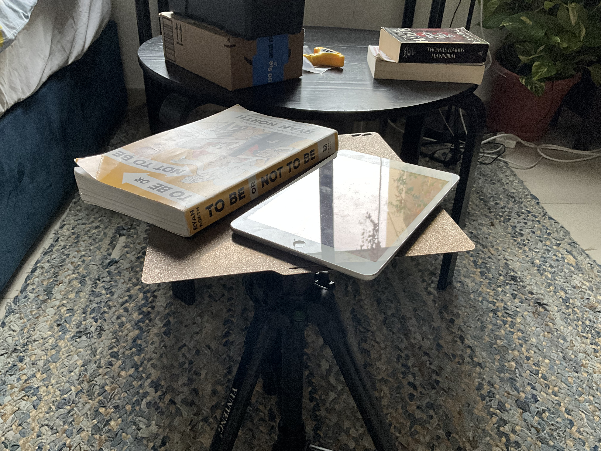

# FieldPlate

**FieldPlate** is a simple tripod attachment for reusing 3D printer build plates as portable tables.

More information and the models can be found on **Printables**:
[[https://www.printables.com/model/1815820]]

## What is FieldPlate?

FieldPlate started as a simple idea: take a 3D printer build plate and turn it into a portable table using a simple attachment system.

It is designed to be somewhat usefull! Well not really, but would you ever really use this?

## What you need/ B.O.M
To get started, you will need:
* 1× compatible PEI build plate
* 12× 11 × 3 mm magnets
*   Smaller magnets can also work
* 1× tripod
* M3 × 8 mm screws
* M3 × 10 mm screws can also work
* PLA filament or PETG. Or ABS! But PLA is soft enough for the screw threads in my opinion
  
## Printing

Download the correct release on github! or just go to the files section and try. Releases can be found on both Printables and GitHub, but Github is where i'll update it the most

Recommended slicer settings:

* Infill: 15%
* Supports: On
* Material: PLA
* Other settings: Default

## How does it work?

The FieldPlate attachment is a simple framework that connects a 3D printer build plate to a tripod.
Magnets hold the build plate in place, while four screw-mounted arms connect the framework to the tripod.
The result is a lightweight, removable table that lets you reuse a build plate outside of your 3D printer. It is great as a foot rest, arm rest, pillow rest, or even a snack table! Remember to wash your build plate though. *shudder*

## Cad Model!

## Credits

*Designed by:* Me!

**Models and project:** FieldPlate

**Printables:**
[[https://www.printables.com/model/1815820]]

If you remix or modify FieldPlate, please credit the original project and link back to this repository.
